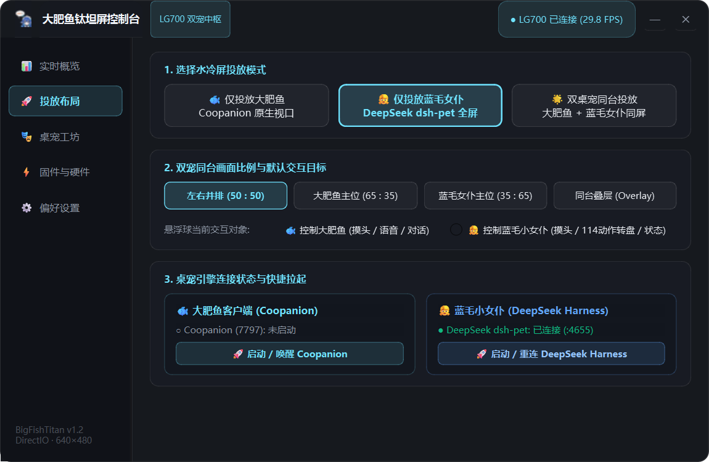
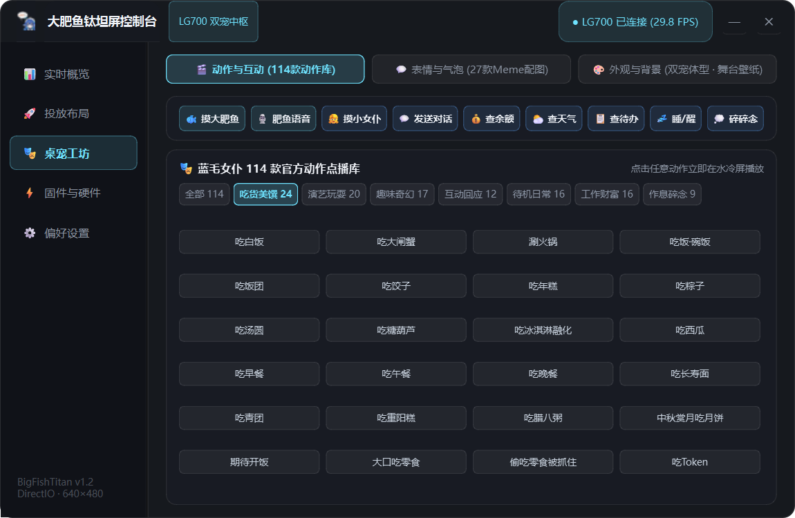
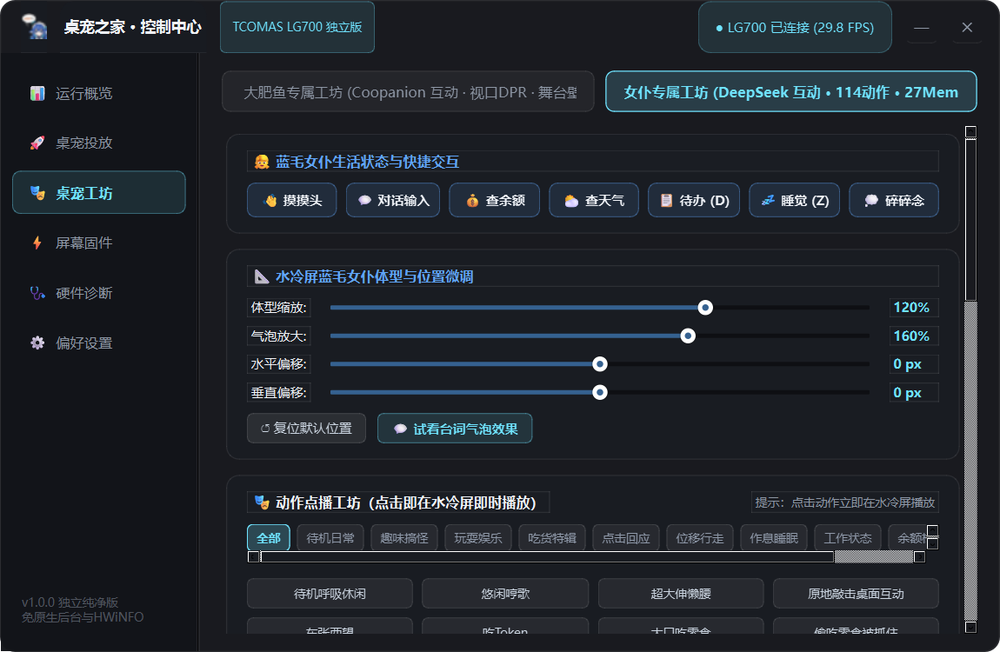
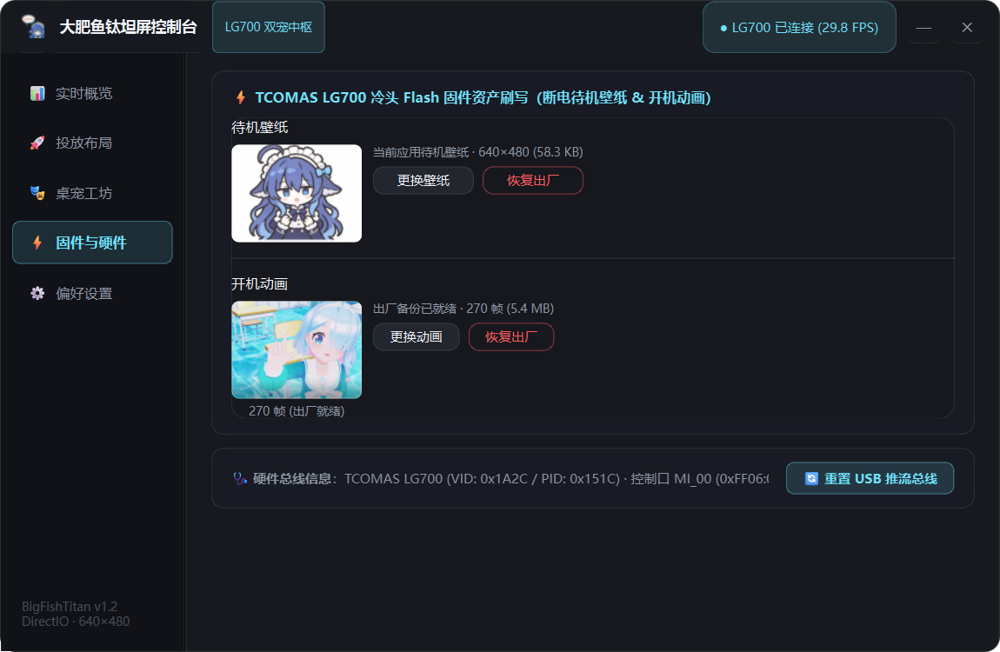
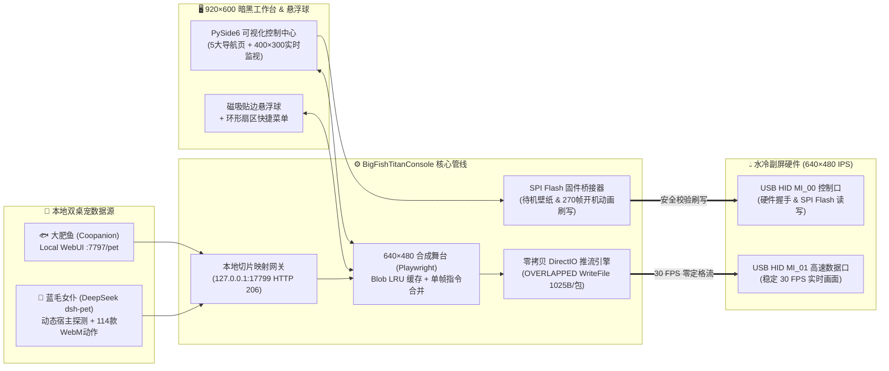

# 🖥️ dsh-pet-on-screen · 大肥鱼桌宠钛坦屏投放工具 (BigFishTitanConsole v1.2)

> **基于 DirectIO USB HID 管道的高性能 640×480 水冷副屏双桌宠协同投放与硬件固件控制台**  
> *High-Performance Dual Desktop Pet Casting & Firmware Management Console for 640×480 USB HID AIO Liquid Cooler LCD Screens (TCOMAS LG700 / DeepSeek dsh-pet / Coopanion).*

<p align="center">
  <a href="LICENSE"></a>
  <a href="https://microsoft.com"></a>
  <a href="https://github.com/fahua408/dsh-pet-on-screen/releases/latest"></a>
  <a href="DISCLAIMER.md"></a>
</p>

---

## 📦 快速下载与开箱即用 (Releases Download)

如果您不需要修改源码，推荐直接前往 **[GitHub Releases 页面](https://github.com/fahua408/dsh-pet-on-screen/releases/latest)** 下载已编译打包的 `v1.2.0` 绿色免安装版：

- 🚀 **最新版本下载**：**[dsh-pet-on-screen-v1.2.0-win64.zip (GitHub Releases)](https://github.com/fahua408/dsh-pet-on-screen/releases/tag/v1.2.0)**
- **快速上手步骤**：
  1. 下载 `dsh-pet-on-screen-v1.2.0-win64.zip` 并解压至任意目录（例如 `D:\dsh-pet-on-screen\`）。
  2. 双击运行 **`BigFishTitanConsole.exe`** 即可直接启动，**无需额外安装 Python 或复杂运行库**。
  3. 启动前请确保水冷屏 USB 数据线已连接，且对应桌宠服务（Coopanion 或 DeepSeek `dsh-pet`）已在后台运行。

---

## 📸 界面预览与实机效果 (Screenshots & Hardware Showcase)

| 水冷屏实机物理效果 (TCOMAS LG700 640×480) | 实时概览 (400×300 大画幅预览与模式/互动速切) |
| :---: | :---: |
|  |  |

| 投放布局中心 (双宠同屏/分屏比例/引擎管理) | 桌宠工坊 · 动作与互动 (全量 114 款动作点播库) |
| :---: | :---: |
|  |  |

| 桌宠工坊 · 外观与背景 (双宠体型位移 · 舞台壁纸) | 固件与硬件管理 (冷头待机壁纸/开机动画刷写) |
| :---: | :---: |
|  |  |

| 桌面极简悬浮球与环形扇区菜单 | 偏好设置 (开机自启/一键深度清理缓存) |
| :---: | :---: |
|  |  |

---

## 🏗️ 系统架构与渲染推流管线 (System Architecture)



---

## 🌟 核心特性 (Key Features in v1.2.0)

1. **双桌宠无缝协同投放 (Dual Pet Cast Architecture)**
   - **单桌宠专属模式**：支持独立投放大肥鱼 (`Coopanion`) 或蓝毛女仆 (`DeepSeek dsh-pet`)。
   - **双桌宠同屏模式**：支持左右并排 (`50:50`)、大肥鱼主位 (`65:35`)、蓝毛女仆主位 (`35:65`) 及同台叠层 (`Overlay`) 4 种排布。
   - **交互目标随心切**：悬浮球、环形菜单与多模态对话框动态识别当前控制目标，双宠模式下支持一键切换交互路由。

2. **零官方常驻依赖与极致推流性能 (Pure DirectIO USB HID Driver)**
   - 彻底摆脱第三方重型水冷控制后台，直接基于 Win32 预分配缓冲区零拷贝 `OVERLAPPED WriteFile` HID 管道与硬件通信。
   - 渲染管线采用 **`fetch + Blob` LRU 内存缓存预热** + **单帧高频指令合并去重** + **双层自愈看门狗**，640×480 满分辨率下稳定 30 FPS 零定格、零流式卡顿；切换至主桌面待机模式时自动进入 0% CPU/GPU 零空耗休眠。

3. **5 大导航 + 3 段式桌宠工坊 (Clean 920×600 Dark Console)**
   - **大肥鱼 (Coopanion)**：直通 WebUI / WebSocket 抚摸交互与对话指令，内置 `Alt×2` 语音快捷呼出，支持 `1.0x ~ 3.2x` DPR 渲染缩放。
   - **蓝毛女仆 (DeepSeek dsh-pet)**：自动从 `~/.dsh/surfcore/pet/host.json` 精准发现宿主动态端口，支持查余额、实时天气气泡、待办事项提醒、睡眠前自动唤醒、多模态图文对话，内置 **全量 114 套官方动作（7 大分类）** 与 **Meme 表情气泡网格**。

4. **安全固件与待机壁纸管理 (Hardware SPI Flash Management)**
   - 支持从硬件 SPI Flash 区域实时读取当前应用的待机静态壁纸，真实展示固件内存储的图片。
   - 预设安全固件校验机制，支持用户自定义刷入 640×480 JPG 待机图片或开机动画帧序列，刷写期间自动挂起/恢复实时推流。

5. **存储与体验优化 (Optimization & Cache Cleaner)**
   - 运行概览窗口配备 400×300 黄金 4:3 实时预览画幅，并集成一键模式速切与常用互动（摸头/对话/余额/天气）。
   - 偏好设置内置 **「一键清理运行缓存与旧日志」** 及 **250ms 防抖异步配置落盘**，拖拽滑块零磁盘 I/O 卡顿。

---

## ⚠️ 核心限制与运行环境 (Technical & Hardware Limitations)

在部署与使用本软件前，请确保满足以下软硬件条件：

1. **硬件规格与测试范围**：
   - 目前仅在搭载 composite HID 控制芯片（VID `0x1A2C`，PID `0x151C`，接口 `MI_00` / `MI_01`）的 640×480 IPS USB 水冷液晶屏幕（如 TCOMAS LG700）上完成实机测试与验证。
   - **不支持** 通过常规 HDMI / DisplayPort / Type-C 传输显卡原生视频信号的显示器副屏。
2. **操作系统**：
   - 仅支持 64 位 Windows 10 / Windows 11。项目深度集成 Windows 原生 `hid.dll`、`user32.dll` 窗口管理及异步 I/O 管道。
3. **本地桌宠服务依赖**：
   - 软件本身为硬件投屏与交互控制中枢，桌宠角色的渲染与逻辑依赖用户本地已安装并运行的对应桌宠程序（如 Coopanion 默认本地 `7797` 端口服务，或 DeepSeek `dsh-pet` 本地桌面服务进程）。
4. **带宽与帧率上限**：
   - 受限于复合 USB HID 协议的物理数据带宽上限，推流帧率最高约为 30 FPS。

---

## 🛠️ 本地源码运行与二次构建 (Developer Guide)

```powershell
# 1. 克隆代码仓库
git clone https://github.com/fahua408/dsh-pet-on-screen.git
cd dsh-pet-on-screen

# 2. 安装依赖环境 (推荐 Python 3.10+)
pip install -r requirements.txt

# 3. 运行控制台主程序
python app/main.py

# 4. 独立打包可执行文件
python build.py
```

---

## ⚖️ 合规声明、AI 辅助声明与版权保护 (Compliance & Legal Disclaimer)

- **独立个人开源项目**：本项目为面向开源社区及硬件玩家的个人技术研究与 DIY 硬件投屏工具，与硬件设备制造厂商（包括但不限于钛坦 / TCOMAS）以及任何第三方桌宠开发团队（包括但不限于 Coopanion、Cortico、DeepSeek 等）无任何官方关联、投资、授权或合作关系。
- **商标与第三方资产归属**：软件在运行过程中所对接或引用的第三方软件名称、商标、角色形象、动作与表情资源的知识产权均归其各自原始权利人所有。本项目默认优先从用户本地已合法安装的桌宠目录加载相关视图资源，不主张任何第三方角色资产的所有权。
- **零隐私收集与纯本地通信**：本工具所有通信均在本地回环地址（`127.0.0.1`）与本地 USB HID 硬件总线之间完成，无任何远程商业后台，不收集、不上传任何用户隐私数据或 API 密钥。
- **AI 辅助生成声明**：本软件的代码架构、协议适配、UI 组件以及文档在人工智能辅助（AI Assistance）下完成，按“现状”（AS-IS）基于 [MIT License](LICENSE) 开源提供，严禁用于任何商业售卖、转售或牟利行为。详细免责条款请参阅 [DISCLAIMER.md](DISCLAIMER.md)。
