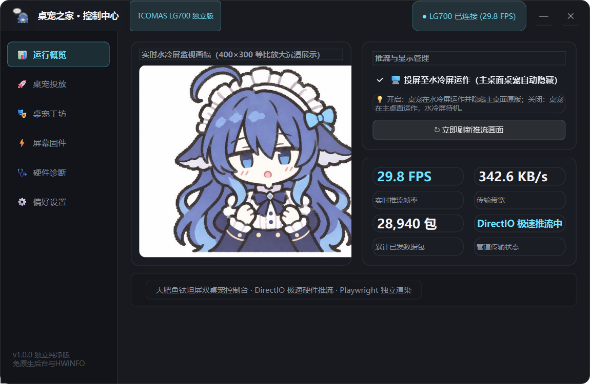
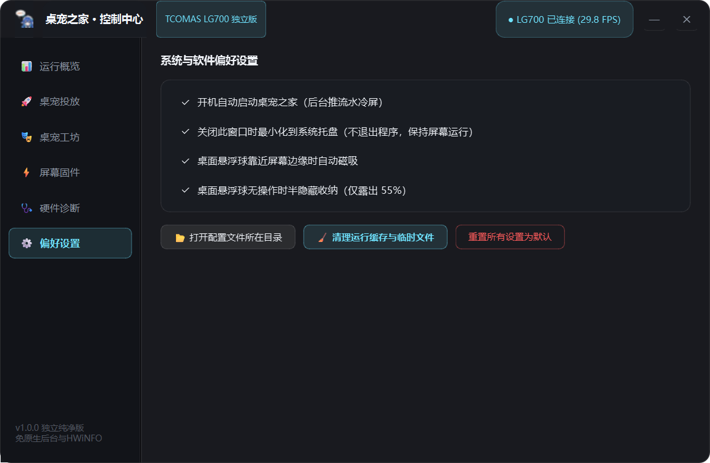
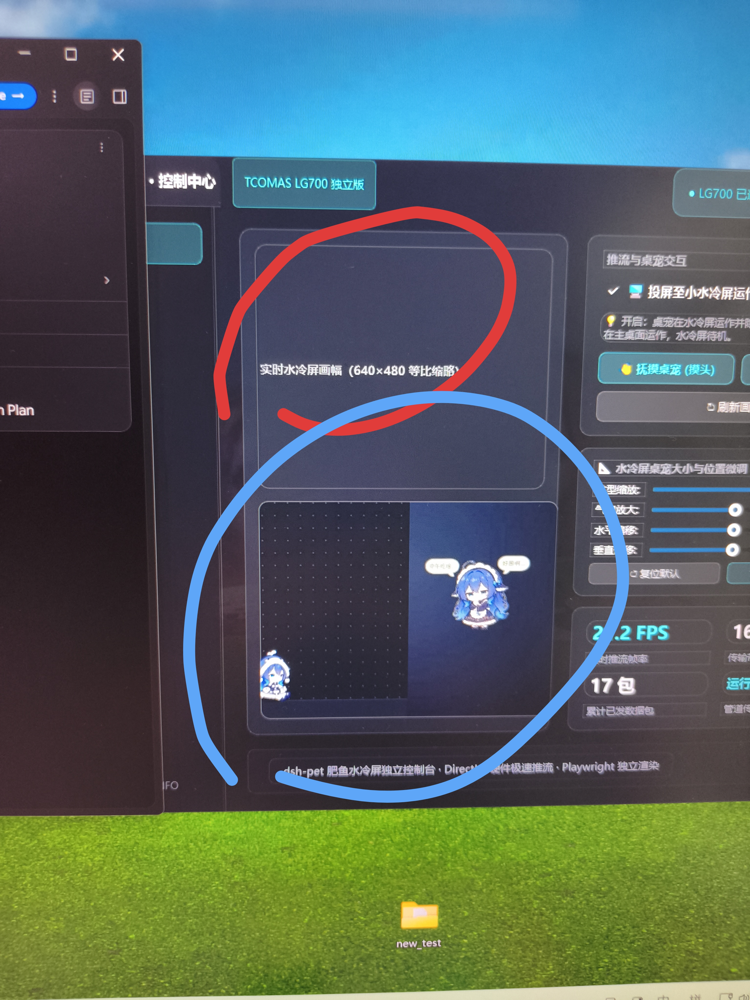

# dsh-pet-on-screen

> **基于 DirectIO HID 管道的高性能 640×480 水冷副屏桌宠投放与硬件控制台**  
> *A high-performance desktop pet casting and hardware management console for 640×480 USB LCD screens via DirectIO HID.*  
> *(注：当前主要在 TCOMAS LG700 等复合 HID 水冷副屏硬件上完成实机测试与验证)*

[](LICENSE)
[](https://microsoft.com)
[](https://github.com/fahua408/dsh-pet-on-screen/releases/latest)
[](DISCLAIMER.md)

---

## 📦 快速下载 (Releases Download)

如果您不需要修改源码，推荐直接前往 **[GitHub Releases 页面](https://github.com/fahua408/dsh-pet-on-screen/releases/latest)** 下载已编译打包的绿色免安装版：

- 🚀 **最新版本下载**：[dsh-pet-on-screen-v1.0.0-win64.zip](https://github.com/fahua408/dsh-pet-on-screen/releases/latest)
- **使用方法**：
  1. 下载解压至任意目录（建议无空格纯英文路径，例如 `D:\dsh-pet-on-screen\`）。
  2. 双击运行 `BigFishTitanConsole.exe`（或发送快捷方式到桌面）即可直接启动，**无需额外安装 Python 或复杂运行库**。
  3. 启动前请确保水冷屏 USB 数据线已连接，且对应桌宠服务已在后台运行。

---

## 📸 界面预览 (Screenshots)

| 运行概览 (400×300 无死角大画幅实时预览) | 投放控制中心 (双宠同屏/独立切换) |
| :---: | :---: |
|  |  |

| 大肥鱼专属工坊 (Coopanion: 抚摸/对话/语音/DPR) | 蓝毛女仆专属工坊 (DeepSeek dsh-pet: 动作/变形) |
| :---: | :---: |
|  |  |

| 屏幕固件管理 (实时读取当前应用待机壁纸) | 设置中心 (开机自启/一键深度清理缓存) |
| :---: | :---: |
|  |  |

| 桌面极简悬浮球 (双宠模式专属快捷切换) | 水冷屏实机物理效果 |
| :---: | :---: |
|  |  |

---

## 🌟 核心特性 (Key Features)

1. **双桌宠无缝协同投放 (Dual Pet Cast Architecture)**
   - **单桌宠专属模式**：支持独立投放大肥鱼 (Coopanion) 或蓝毛女仆 (DeepSeek dsh-pet)。
   - **双桌宠同屏模式**：支持画中画 (Picture-in-Picture) 及左右分屏排布。
   - **交互目标随心切**：悬浮球与控制台动态识别当前推流目标，多桌宠运行时自动展开交互路由切换按键。

2. **零官方常驻依赖 (Pure DirectIO USB Driver)**
   - 彻底摆脱第三方重型水冷控制后台，直接基于 Win32 Overlapped HID 管道与硬件通信。
   - 采用 JPEG 高压缩帧流水线，640×480 满分辨率输出下稳定达到 30 FPS 上限，CPU 占用极低。

3. **模块化专属工坊 (Dedicated Pet Workshops)**
   - **大肥鱼 (Coopanion)**：直通 WebUI / WebSocket 抚摸交互与对话指令，内置 Alt×2 语音快捷呼出，独家提供 1.0x ~ 3.2x DPR 渲染缩放及 6 款 640×480 高清主题壁纸。
   - **蓝毛女仆 (DeepSeek dsh-pet)**：角色缩放 (50%~150%)、气泡比例 (80%~200%) 与坐标偏移微调，内置 114 套动作与 27 套表情包切换。

4. **安全固件与待机壁纸 (Hardware Flash Management)**
   - 支持从硬件 SPI Flash 区域实时反读当前已应用的待机静态壁纸，真实展示固件内存储的图片。
   - 预设安全固件校验机制，支持用户自定义刷入 640×480 JPG 待机图片或开机动画帧序列。

5. **存储与体验优化 (Optimization & Cache Cleaner)**
   - 运行概览窗口扩大 56%（由原 320×240 扩展至 400×300 黄金 4:3 比例），消除无用黑边死角。
   - 设置中心内置 **「一键清理运行缓存与临时文件」**，自动释放 Web 渲染缓存与临时推流帧缓冲。

---

## ⚠️ 核心限制与运行环境 (Technical & Hardware Limitations)

在部署与使用本软件前，请确保满足以下软硬件条件：

1. **硬件规格与测试范围**：
   - 目前仅在搭载 composite HID 控制芯片（VID `0x1A2C`，PID `0x151C`，接口 MI_00 / MI_01）的 640×480 IPS USB 水冷液晶屏幕（如 TCOMAS LG700）上完成实机测试与验证。
   - **不支持** 通过常规 HDMI / DisplayPort / Type-C 传输显卡原生视频信号的显示器副屏。
2. **操作系统**：
   - 仅支持 64 位 Windows 10 / Windows 11。项目深度集成 Windows 原生 HID.dll、User32 窗口拦截及异步管道。
3. **本地桌宠服务依赖**：
   - 软件本身为投放控制中枢，桌宠角色的渲染与逻辑依赖对应桌宠程序正常运行（如 Coopanion 默认本地 7797 端口服务，或 dsh-pet 桌面服务进程）。
4. **带宽与帧率上限**：
   - 受限于复合 USB HID 协议的物理数据带宽上限，推流帧率最高约为 30 FPS。

---

## 🤖 AI 辅助生成声明 (AI Generation Notice)

- 本软件的代码架构、协议适配、UI 组件开发以及文档生成均在 **人工智能辅助（AI Assistance）** 下完成。
- 项目按“现状”（AS-IS）提供，不包含任何明示或暗示的商业担保、功能担保或无缺陷担保。使用者应自行对运行环境及硬件安全负责。

---

## 📜 免责声明与版权保护 (Disclaimer & Intellectual Property)

- **独立个人项目**：本项目为面向开源社区及硬件玩家的个人技术研究与 DIY 适配工具，与硬件设备厂商（包括但不限于钛坦/TCOMAS）以及任何第三方桌宠开发团队（包括但不限于 Coopanion、Cortico、DeepSeek 等）无任何官方关联、投资、授权或合作关系。
- **测试范围**：本项目仅对特定硬件（TCOMAS 复合 HID 水冷屏）进行了驱动通讯测试，不构成对任何品牌的商业背书。
- **商标与资产归属**：所有第三方名称、商标、软件图标、角色形象版权均归其各自原始著作权人所有。本项目不主张任何侵权权利，亦不包含商业侵权代码。
- **非商业用途**：本项目严禁用于任何形式的商业转售、牟利或商业分发。
- 详细免责条款请参阅：[DISCLAIMER.md](DISCLAIMER.md)。

---

## 🛠️ 本地源码运行与二次构建 (Developer Guide)

```powershell
# 1. 克隆代码仓库
git clone https://github.com/fahua408/dsh-pet-on-screen.git
cd dsh-pet-on-screen

# 2. 安装依赖环境 (推荐 Python 3.10+)
pip install -r requirements.txt

# 3. 运行控制台主程序
python main.py

# 4. 独立打包可执行文件
pyinstaller --clean pet_titan.spec
```

---

*Author: fahua408*  
*Project Name: dsh-pet-on-screen*
